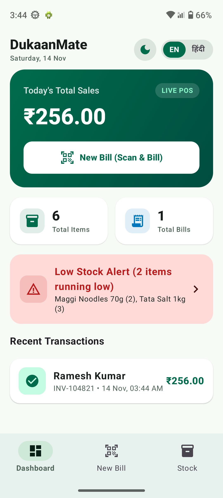
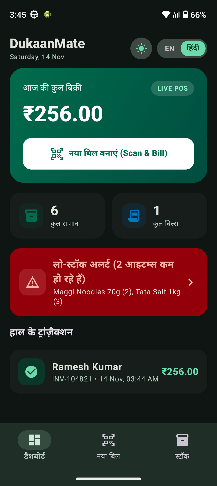
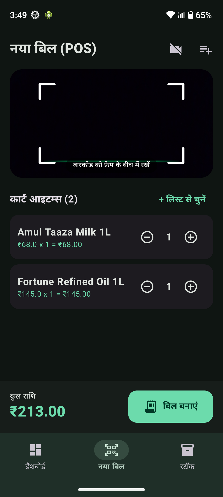
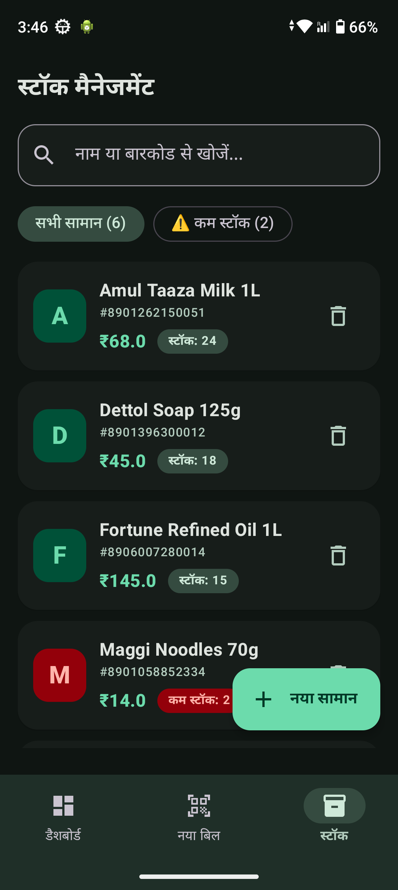

# 🏪 DukaanMate — Offline POS Billing & Smart Inventory Android App


**DukaanMate** is a modern, offline-first Point of Sale (POS) billing and inventory management Android application designed for small retail businesses (Kirana stores, pharmacies, garment shops, and general stores). Built with **100% Kotlin**, **Jetpack Compose**, and **Clean MVVM Architecture**, it enables shopkeepers to scan product barcodes, manage low-stock alerts, generate professional PDF invoices, and share bills directly via WhatsApp—without needing an active internet connection.

---

## 📱 Download APK

You can download the pre-built ready-to-test APK from the repository:
* 📥 **[Download DukaanMate v1.0 APK](apk/dukaanmate-v1.0.apk)**

---

## ✨ Key Features

* **⚡ Live Camera Barcode Scanner:** Real-time EAN-13, UPC, and QR code scanning powered by **CameraX** and **Google ML Kit** with an animated laser viewfinder and audio beep feedback.
* **🧾 Instant POS Billing & Cart:** Scan items directly into the cart or pick manually, adjust quantities, and automatically deduct sold stock via atomic Room database transactions.
* **📄 Native PDF Invoice & WhatsApp Share:** Generates clean A5 thermal/digital PDF receipts using Android's `PdfDocument` API and shares them directly to the customer's WhatsApp via `FileProvider`.
* **📦 Smart Inventory & Low-Stock Alerts:** Real-time dashboard alerts and quick-filter chips (`All Items` / `Low Stock`) when product quantities drop below custom threshold limits.
* **🌐 Instant Bilingual Support (English & हिंदी):** One-tap live language toggle (`EN` / `हिंदी`) across the entire app using Jetpack Compose `CompositionLocal`, persisted locally via `SharedPreferences`.
* **🌗 Dynamic Light & Dark Mode:** Seamless Material 3 Light and Deep Emerald Dark themes with automatic system status bar adaptation and persistent state.

---

## 🛠️ Tech Stack

* **UI Framework:** Jetpack Compose (Material 3 Design System)
* **Language:** Kotlin (Coroutines & `StateFlow`)
* **Dependency Injection:** Koin (`koin-android`, `koin-androidx-compose`)
* **Local Persistence:** Room Database (Entities, DAOs, `@Transaction` queries) & `SharedPreferences`
* **Computer Vision & Camera:** Google ML Kit Barcode Scanning + Android CameraX
* **PDF Generation:** Android Native `android.graphics.pdf.PdfDocument` + `FileProvider`
* **Navigation:** Jetpack Compose Navigation

---

## 🏗️ Architecture & Project Structure

**DukaanMate** is built using **Clean MVVM Architecture** paired with **Koin Dependency Injection**, ensuring unidirectional data flow, reactive UI updates via Kotlin `StateFlow`, and 100% offline reliability.

### 🔄 Data Flow Overview

```text
[ Jetpack Compose UI ] ◄──(StateFlow)──► [ DukaanViewModel ] ◄──► [ DukaanRepository ] ◄──► [ Room DB & SharedPrefs ]
         ▲                                                                                          │
         └──────────────────────────(Koin Dependency Injection)─────────────────────────────────────┘
```

### 📂 Exact Package Hierarchy

```text
com.portfolio.dukaanmate/
├── 📄 DukaanMateApp.kt                      # Application entry point; initializes Koin DI container
├── 📄 MainActivity.kt                       # Single-Activity host; manages Edge-to-Edge & Dynamic Theme
│
├── 📁 di/                                   # Dependency Injection Layer
│   └── 📄 AppModule.kt                      # Koin module binding Room DB, DAOs, Preferences, Repo & ViewModel
│
├── 📁 data/                                 # Data & Persistence Layer
│   ├── 📁 local/
│   │   ├── 📁 entity/                       # Room Database Tables
│   │   │   ├── 📄 ProductEntity.kt          # Product schema with unique barcode index
│   │   │   ├── 📄 InvoiceEntity.kt          # Billing header schema (customer, total, timestamp)
│   │   │   └── 📄 InvoiceItemEntity.kt      # Line-item schema with foreign-key cascade delete
│   │   ├── 📁 dao/                          # Data Access Objects (SQL & Flow Queries)
│   │   │   ├── 📄 ProductDao.kt             # Barcode lookup, low-stock filters & atomic stock deduction
│   │   │   └── 📄 InvoiceDao.kt             # Invoice persistence & daily revenue aggregation
│   │   ├── 📄 DukaanDatabase.kt             # Room Database configuration & version management
│   │   └── 📄 LanguagePreferences.kt        # SharedPreferences wrapper for persistent Theme & Language
│   └── 📁 repository/                       # Repository Pattern (Abstraction over Data Sources)
│       ├── 📄 DukaanRepository.kt           # Clean contract for domain/UI consumption
│       └── 📄 DukaanRepositoryImpl.kt       # Coordinates atomic @Transaction billing & stock updates
│
├── 📁 domain/                               # Domain Layer
│   └── 📁 model/
│       └── 📄 CartItem.kt                   # Pure Kotlin model representing active POS cart items
│
├── 📁 ui/                                   # Presentation Layer (100% Jetpack Compose + Material 3)
│   ├── 📁 localization/                     # Instant Bilingual Engine (English & हिंदी)
│   │   └── 📄 AppStrings.kt                 # Type-safe string definitions & CompositionLocal provider
│   ├── 📁 navigation/                       # App Navigation Graph
│   │   └── 📄 DukaanMateRoot.kt             # Material 3 Scaffold, Bottom Navigation Bar & NavHost
│   ├── 📁 theme/                            # Design System
│   │   ├── 📄 Color.kt                      # Light & Dark Emerald-Slate color palettes
│   │   ├── 📄 Theme.kt                      # Dynamic DukaanMateTheme composable
│   │   └── 📄 Type.kt                       # Material 3 typography scale
│   ├── 📁 viewmodel/                        # State Management
│   │   └── 📄 DukaanViewModel.kt            # Exposes reactive StateFlows & handles POS cart actions
│   ├── 📁 components/                       # Modular, Reusable UI Widgets
│   │   ├── 📄 BarcodeScannerView.kt         # CameraX + ML Kit scanner with animated laser viewfinder
│   │   ├── 📄 LanguageTogglePill.kt         # Instant [ EN | हिंदी ] switcher pill
│   │   ├── 📄 ThemeToggleButton.kt          # Light / Dark mode circular toggle
│   │   ├── 📄 StatMiniCard.kt               # Dashboard metric summary card
│   │   ├── 📄 CartItemRow.kt                # POS cart item row with +/- quantity controls
│   │   ├── 📄 ProductStockCard.kt           # Inventory card with avatar badge & low-stock indicator
│   │   └── 📄 AddProductDialog.kt           # Product creation modal with inline barcode scanning
│   └── 📁 screens/                          # Feature Screens
│       ├── 📄 DashboardScreen.kt            # Daily sales hero card, low-stock banner & recent bills
│       ├── 📄 BillingScreen.kt              # Live POS scanner, active cart & customer checkout
│       └── 📄 InventoryScreen.kt            # Searchable & filterable stock management screen
│
└── 📁 utils/                                # Platform Utilities
    └── 📄 PdfInvoiceHelper.kt               # Native PdfDocument canvas renderer & WhatsApp FileProvider share
```

### 🧩 Layer Responsibilities

| Layer | Responsibility | Key Technologies |
| :--- | :--- | :--- |
| **UI (`ui/`)** | Renders reactive Material 3 screens, handles bilingual strings & themes without business logic. | Jetpack Compose, Navigation, `CompositionLocal` |
| **ViewModel (`ui/viewmodel/`)** | Holds UI state (`StateFlow`, `mutableStateListOf`) and survives configuration changes. | AndroidX ViewModel, Kotlin Coroutines |
| **Domain (`domain/`)** | Defines clean, framework-independent business models used across billing flows. | Pure Kotlin Data Classes |
| **Data (`data/`)** | Single source of truth for offline storage, atomic stock updates, and user settings. | Room DB (`@Transaction`), Flow, SharedPreferences |
| **DI (`di/`)** | Decouples object creation and injects dependencies cleanly into Composables. | Koin (`koinViewModel`, `single`) |

---

## 📸 Screenshots

| Dashboard (Light Mode) | Dashboard (Dark / हिंदी) | Live Laser POS Scanner | Stock & Low-Stock Alerts |
| :---: | :---: | :---: | :---: |
|  |  |  |  |

---

## 🚀 Getting Started

1. **Clone the repository:**
   ```bash
   git clone https://github.com/RaviYadavO4/DukaanMate.git
   ```
2. **Open in Android Studio:**
   Open the project in **Android Studio Ladybug (or newer)** with JDK 17+.
3. **Sync Gradle & Run:**
   Allow Gradle to sync dependencies and run the app on a physical Android device (recommended for testing live camera barcode scanning and WhatsApp PDF sharing).

---

## 💼 Freelance & Commercial Extensibility

This codebase is structured for rapid client customization and white-labeling:
* **Thermal Printing:** Ready to plug in 58mm / 80mm Bluetooth ESC/POS thermal printer SDKs.
* **GST & Tax Compliance:** Easily extendable for CGST / SGST slab calculations on PDF invoices.
* **Cloud Sync:** Repository abstraction allows adding encrypted Google Drive or Firebase backup without touching UI code.

---

## 👨‍💻 Author

Built as a flagship Android POS & Inventory portfolio project. Feel free to ⭐ star the repository or connect for custom Android app development!
